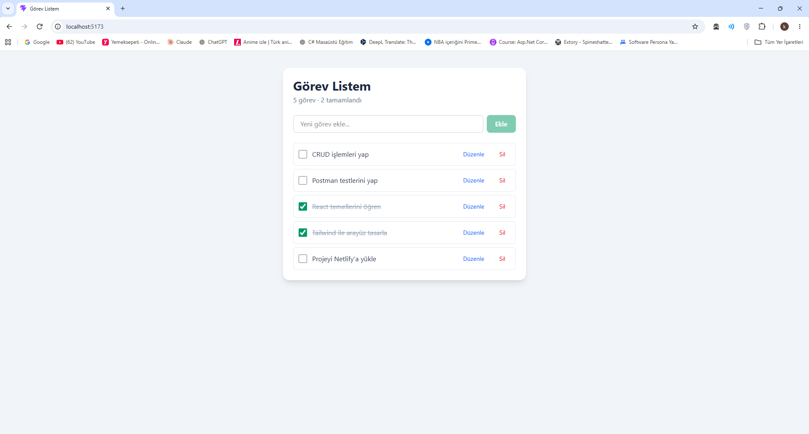
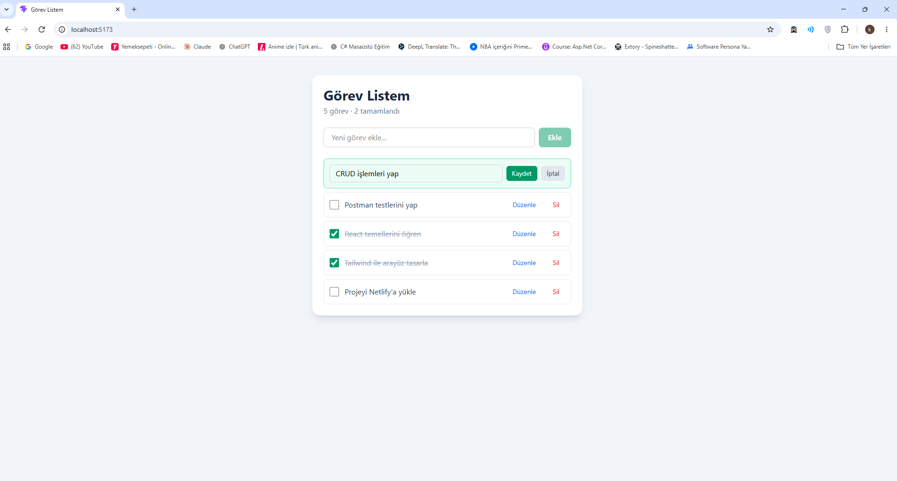

# Görev Listem – React TODO Uygulaması

React ve Tailwind CSS ile geliştirilmiş, görev ekleme, listeleme, güncelleme ve silme işlemlerini destekleyen bir TODO uygulamasıdır. Veriler tarayıcının LocalStorage alanında saklanır; sayfa yenilendiğinde kaybolmaz.

🔗 **Canlı Demo:** NETLIFY_LINKI

## Özellikler

- **Ekle:** Yeni görev ekleme (boş görev eklenemez, Enter tuşu ile de eklenebilir)
- **Listele:** Tüm görevleri, toplam ve tamamlanan görev sayısıyla görüntüleme
- **Güncelle:** Görevi tamamlandı olarak işaretleme ve görev başlığını düzenleme (Enter: kaydet, Escape: iptal)
- **Sil:** Görevi listeden kaldırma
- **Kalıcılık:** Tüm değişiklikler LocalStorage'a otomatik kaydedilir

## Kullanılan Teknolojiler

- **React 19** – Arayüz kütüphanesi
- **Vite** – Geliştirme ve derleme aracı
- **Tailwind CSS 4** – Stil
- **LocalStorage** – Veri saklama
- **Netlify** – Yayınlama

## Klasör Yapısı

```
src/
├── components/
│   ├── TodoForm.jsx     # Görev ekleme formu
│   ├── TodoItem.jsx     # Tek görev satırı (güncelleme ve silme)
│   └── TodoList.jsx     # Görev listesi
├── interfaces/
│   └── todo.js          # Görev veri modeli
├── pages/
│   └── HomePage.jsx     # Ana sayfa, state ve CRUD fonksiyonları
├── App.jsx
├── main.jsx
└── index.css
```

## Kurulum ve Çalıştırma

**Gereksinimler:** Node.js (v18 veya üzeri)

```bash
git clone https://github.com/Kaganucar/todo-app.git
cd todo-app
npm install
npm run dev
```

Uygulama `http://localhost:5173` adresinde açılır.

Yayın için derleme:

```bash
npm run build
```

## Ekran Görüntüleri

**Görev listesi**



**Düzenleme modu**



## Hazırlayan

**Kağan Uçar** – Web Geliştirme; JavaScript Projesi, 2026